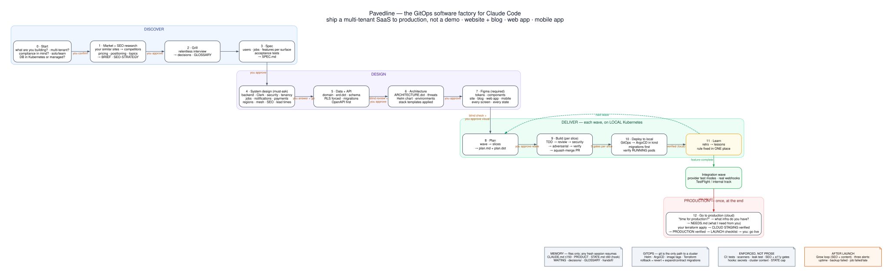

# Pavedline

**Ship a multi-tenant SaaS to production with Claude Code, not a demo.**

The GitOps software factory for serious builders: idea → market → spec → system design → Figma → tested code →
local Kubernetes → cloud staging → production. Website, blog, web app and mobile app, built as one product.

> **Status: steps 0–12 work, from the first question to production.** Each step was run on a private trial product,
> and CI deploys a generated starter product to local Kubernetes on every pull request. The latest tagged release is
> still v0.1; the next release will carry all of it. Every feature below is marked with the release that delivers it.

<p align="center"></p>

> **Built for:** people who have built and shipped software before (developers, tech leads, DevOps, DevSecOps and
> platform engineers) building a real, multi-tenant product that people will pay for and depend on.
>
> **An advanced workflow.** It expects you to read a pull request, a Kubernetes manifest and a database schema, and to
> make the decisions it puts in front of you. It is not a no-code tool.
>
> **Not for:** weekend demos, one-prompt apps, or anyone who wants an agent to merge code nobody reviewed.
>
> **Privacy:** Pavedline collects nothing. Every answer stays in your own repository.

## What it sets up on your machine

Most agent skill packs only write prompts and code. Pavedline also runs real infrastructure: from the first deploy,
your product runs on a **complete local Kubernetes cluster with GitOps**, the same way it will run in production.
When your project reaches the local cluster, Pavedline creates:

| What | Details |
|---|---|
| **A Kubernetes cluster** | [kind](https://kind.sigs.k8s.io/) v0.33.0, Kubernetes v1.37.0 (node image pinned by digest). Cluster `pavedline-<project>`, kube context `kind-pavedline-<project>` |
| **Argo CD** | Helm chart 10.15.0 in namespace `argocd`. Every deploy goes through Git, as in production |
| **CloudNativePG** | Helm chart 0.29.1 in namespace `cnpg-system`. `verify.sh` brings up a one-instance Postgres to prove it works, then deletes it |
| **Gateway API and Envoy Gateway** | The Gateway API standard CRDs and the Envoy Gateway controller; the shared Gateway answers HTTP on host port 8080 |
| **A local image registry** | Container `kind-registry` on `localhost:5001` |
| **A local git server** | Container `kind-git` (read-only `git daemon`, no host port); Argo CD syncs the apps from it |
| **Ports** | `127.0.0.1:8080` → the shared Gateway (HTTP). Everything binds to loopback only; nothing is exposed to your network |

**What to expect:**
- **It downloads.** The first run pulls a few GB of container images (the Kubernetes node, Argo CD, CloudNativePG,
  Postgres). The whole stack is up in about a minute (56 s on the test Mac, about 1.5 minutes on GitHub's Linux
  runner). If a download fails, the scripts retry it, and re-running `up.sh` reuses whatever is already done.
- **It needs helm 4.2.2 or newer.** helm 4.2.1 has a [known bug](https://github.com/helm/helm/issues/32214) that
  stretches the Argo CD install to about 40 minutes; `up.sh` and `/pavedline:doctor` stop and tell you to upgrade.
- **It asks first.** Missing tools (a container runtime, `kind`, `kubectl`, `helm`) are installed by Pavedline only
  after it tells you what and why, and Claude Code asks your permission for each command. A hook blocks mutating
  cluster commands on any context that is not `kind-pavedline-*`, so your other clusters are safe.
- **It removes cleanly.** `down.sh <project>` deletes the cluster; `down.sh <project> --all` also removes the
  registry container.

**Tested on:**
- **macOS 26 on Apple silicon (arm64) with Colima:** a full `up`, `verify`, `down` run passed on 2026-11-08.
- **Linux arm64 (Ubuntu 24.04):** the same scripts run in CI on every pull request.
- **Linux x86_64:** not tested yet. kind, Argo CD and CloudNativePG all publish amd64 images, so it is expected to
  work; reports are welcome. On Linux, `/pavedline:doctor` points to each tool's official install page.
- **Windows:** not supported (WSL 2 untested).

## What you end up with

When the flow is complete, your product lives in one repository like this. It is the **target layout**: v0.1 creates
the memory files and `docs/`; `apps/`, `services/` and `infra/` arrive with the build steps (v0.3). Step 4 can change
the backend or auth choice, and the tree follows it.

```
your-product/
├── CLAUDE.md · PRODUCT.md · STATE.md · WAITING.md · GLOSSARY.md   memory: any session resumes from files
├── RUN.md · SERVICES.md · LINKS.md          how to run it · every third party · every link used
├── ARCHITECTURE.dot/.svg                    the whole system as a diagram
├── apps/
│   ├── site/        website + blog (Next.js, SEO-gated)
│   ├── web/         web app (Next.js)
│   └── mobile/      iOS + Android (Expo)
├── services/api/    backend (FastAPI) + database migrations
├── packages/        API client generated from OpenAPI · design tokens
├── infra/
│   ├── helm/        hardened base chart, values per environment
│   ├── k8s/         Argo CD watches this: the only way anything reaches a cluster
│   └── profiles/    your cloud, set up at step 12
├── docs/            business · spec · data (ERD) · API · architecture · design · plans · production · growth
├── decisions/       one record per decision, with the reason
└── .github/         CI gates · scanners · Renovate
```

## Install

Pavedline is a Claude Code plugin. It is not in Claude Code's built-in list: you get it from this GitHub repository,
`Marwan-G/pavedline`, which is also a plugin **marketplace** (a catalogue Claude Code can install plugins from).
Pavedline needs a few plugins from two Anthropic marketplaces, so you add three marketplaces once, then install.

You need [Claude Code](https://code.claude.com/docs/en/setup) installed and signed in.

**1. Start Claude Code** in a new, empty folder for your product:

```bash
mkdir my-product && cd my-product
claude
```

**2. Add the marketplaces.** Type each line at the Claude Code prompt (where you chat with Claude, not in your shell),
one at a time:

```
/plugin marketplace add anthropics/claude-plugins-official
/plugin marketplace add anthropics/knowledge-work-plugins
/plugin marketplace add Marwan-G/pavedline
```

| Marketplace | Why you add it |
|---|---|
| `anthropics/claude-plugins-official` | Pavedline's dependencies `superpowers`, `mattpocock-skills` and `figma` |
| `anthropics/knowledge-work-plugins` | Pavedline's dependency `product-management` |
| `Marwan-G/pavedline` | Pavedline itself |

Optional: `/plugin marketplace add nextlevelbuilder/ui-ux-pro-max-skill`. This marketplace line is optional:
`ui-ux-pro-max` is a step-7 style reference, used only if installed.

**3. Install Pavedline:**

```
/plugin install pavedline@pavedline
```

`pavedline@pavedline` means "the plugin `pavedline` from the marketplace `pavedline`". If Claude Code asks for a scope,
choose user scope. The four dependencies install with it, because their marketplaces are already added. If the
summary says `Run /reload-plugins to apply.`, run `/reload-plugins` (or quit and run `claude` again).

**4. Start:**

```
/pavedline:start
```

**From your shell instead:** the same steps work outside Claude Code with `claude plugin marketplace add <name>` and
`claude plugin install pavedline@pavedline`; the plugin loads the next time you run `claude`. (Verified on a clean
profile with `scripts/install_test.sh`.)

**Optional extras:** `claude plugin install marketing@knowledge-work-plugins` for the Grow loop after launch, and
`claude plugin install pavedline-cockpit@pavedline` adds a status pane (needs Claude Code 2.1.287 or newer; nothing in
Pavedline depends on it). For step 12 on OCI you also need OpenTofu or Terraform; the bring-your-own profile needs
neither.

**If `/pavedline:start` is not found:** a missing dependency stops Pavedline from loading at all. Run
`claude plugin list`, which shows the dependency warning, then add the missing marketplace from step 2 and install
again. `Plugin "pavedline" not found in marketplace` means your copy of the catalogue is old: run
`/plugin marketplace update pavedline`.

Once Pavedline loads, `/pavedline:doctor` checks every tool and skill Pavedline needs. For anything missing, Pavedline tells you what it will install, why and
the exact command, then installs it; Claude Code asks your permission for each command. It never uses `sudo`, and a
new paid service or account still needs your go first.

## What works today

- **Steps 0–3, discover:** [start](docs/steps/00-start.md) · [market and SEO research](docs/steps/01-market.md) ·
  [grill](docs/steps/02-grill.md) · [spec](docs/steps/03-spec.md).
- **Steps 4–7, design:** [system design](docs/steps/04-system-design.md) · [data and API](docs/steps/05-data-and-api.md) ·
  [architecture](docs/steps/06-architecture.md) · [Figma](docs/steps/07-figma.md).
- **Steps 8–11, deliver on local Kubernetes:** [plan](docs/steps/08-plan.md) · [build with five gates](docs/steps/09-build.md) ·
  [deploy to local](docs/steps/10-deploy.md) · [learn](docs/steps/11-learn.md), with the `nextjs-fastapi` stack pack.
- **Production, once:** [the integration wave](docs/steps/integration-wave.md) · [step 12, go to production](docs/steps/12-go-to-production.md)
  (two infra profiles, staging then production, a blocking launch checklist, backups and a restore drill, three alerts) ·
  then [the Grow loop](docs/steps/grow.md).
- **Memory in your repository:** `PRODUCT.md`, `STATE.md`, `WAITING.md`, `GLOSSARY.md` and numbered decision records,
  so a fresh session resumes from files.
- **Eleven hooks:** block `.env` reads and secrets written into files; block cluster commands outside the local
  `kind-pavedline-*` cluster; block `--no-verify` and force-pushes to the main branch; block a `STATE.md` over 60
  lines; warn when `CLAUDE.md` passes 150 lines; warn when a pull request body lacks the gates line; warn when code
  changes under a folder whose `ARCHITECTURE.dot` did not; print the project state when a session starts; keep the key `STATE.md` lines through compaction; remind Claude to commit uncommitted records when a turn ends; warn when a builder agent's report lacks its status or gates line.
- **`/pavedline:doctor`:** checks the machine and plugins; for anything missing it tells you what it will install and why, then installs it.
- **Local cluster scripts:** a kind cluster with Argo CD, CloudNativePG and a local image registry, with `up`,
  `verify` and `down` scripts. See [environments](docs/environments.md).
- **CI for the factory itself:** tests, secret scan, diagram checks and a full local-cluster smoke test (kind, Argo CD, CloudNativePG, Postgres) on Linux arm64, on every pull request.

Questions: [FAQ](docs/faq.md).

---

## Why Pavedline exists

**The skills are great. The path is missing.**

Today's best agent kits are excellent parts: a build discipline, a spec format, a large toolbox, sharp
interrogation skills. Their focus is general, and deliberately so. Pavedline's focus is different: **one path, end to
end, for one kind of product**, from the first idea to a multi-tenant SaaS running in production.

That path is where AI-built products stall. Developers say it plainly:

> "Vibe coding is great for a PoC but we usually do a full rewrite until it's production ready."
> — [Hacker News, 2026](https://news.ycombinator.com/item?id=47169540)

> "Each session is a blank slate."
> — [Hacker News, 2026](https://news.ycombinator.com/item?id=47929504)

- **66%** of developers name "AI solutions that are almost right, but not quite" as a frustration, **45.7%**
  distrust the accuracy of AI output, and **77.5%** say vibe coding is not part of their professional work.
  ([Stack Overflow Developer Survey 2025](https://survey.stackoverflow.co/2025/ai))
- AI-generated code introduced security vulnerabilities in **45%** of cases in tests across 100+ models.
  ([Veracode, 2025](https://www.veracode.com/press-release/ai-generated-code-poses-major-security-risks-in-nearly-half-of-all-development-tasks-veracode-research-reveals/))

Pavedline is the paved road through that gap. It is distilled from building and running a real production platform
end to end, and from every place where that went wrong.

## What makes it different

| The usual way | Pavedline | Release |
|---|---|---|
| General skills you assemble yourself | **One path, step 0 → production.** Every step has inputs, output files, an owner and your approval | v0.1 → v0.4 |
| Context lost every session | **Memory lives in the repo:** `PRODUCT.md`, `STATE.md`, decision records, a glossary. A fresh session or a new teammate resumes from files | v0.1 |
| Questions asked again and again | **Each kind of question has one owner** and is asked once, at the step where it matters | v0.1 |
| Multi-tenancy bolted on later | **The first architecture question.** Row-level security forced on every table; a cross-tenant leak test at the merge gate | v0.2 → v0.3 |
| "The agent wrote it, looks fine" | **Five gates per change:** tests first · blind code review · security review · adversarial review · verification. Scanners fail CI like a failing test | v0.3 |
| Deployment is "your problem" | **GitOps from day one:** Helm and ArgoCD, every wave verified on Kubernetes on your machine | v0.1 (cluster) → v0.3 |
| The website is an afterthought | **Website, blog, web app and mobile app** from one design system, with SEO and accessibility gates | v0.2 → v0.3 |
| You find out late what it needs | **Accounts asked just in time.** Production infrastructure is asked once, at the end, with a list of exactly what is needed from you | v0.4 |
| Rules written in prose | **Rules enforced** by CI and hooks | v0.1 → v0.3 |

## Is this waterfall?

No. Steps 0–7 decide the **expensive** things once, before code makes them costly to change: tenancy, data, auth,
architecture, design. After that, work ships in **small waves** of slices, each tested, reviewed and running on
Kubernetes. Any earlier step can be reopened with a recorded decision. A small fix takes the light path straight to
build.

## The flow

| | Steps | You get |
|---|---|---|
| **Discover** | 0 Start · 1 Market + SEO · 2 Grill · 3 Spec | your product statement and first decisions, a competitor and pricing brief, an SEO strategy, a glossary, a spec with acceptance tests |
| **Design** | 4 System design · 5 Data + API · 6 Architecture · 7 Figma | answers to every must-ask question (backend, auth, security, jobs, notifications, payments, regions), schema and ERD, OpenAPI, diagrams, every screen in every state |
| **Deliver** | 8 Plan · 9 Build · 10 Deploy to local · 11 Learn | waves of tested, reviewed slices running on a real cluster on your machine |
| **Production** | 12 Go to production | cloud staging, then production, verified, behind a launch checklist. Asked once, when everything works |

How Pavedline itself is built and checked: [architecture](docs/architecture.md).

## Requirements

Asked for **just in time**, never all on day one:

| You need | When | Cost |
|---|---|---|
| GitHub account (+ GHCR) | step 0 | free for public repos; private-repo CI minutes are billed |
| Claude Code | step 0 | your Claude plan or API |
| A Mac or Linux machine, 16 GB memory (32 GB recommended), a container runtime | step 0 | — |
| Figma, **Full seat** | step 7 | paid |
| Authentication: Clerk by default, or the provider you choose at step 4 (for example Supabase) | first auth slice | per provider pricing |
| Apple Developer Program · Google Play Console | before the first mobile build | yearly fee · one-time fee |
| A Kubernetes cluster (OCI profile included, or your own) · domain + Cloudflare · S3-compatible storage | step 12 | your cloud bill |
| Google Search Console · Bing Webmaster Tools | step 12 | free |

## Roadmap

| Release | What works | State |
|---|---|---|
| **v0.1** | steps 0–3 · memory files and hooks · `doctor` · local Kubernetes cluster (kind + ArgoCD + CNPG) · CI for the factory itself | released |
| **v0.2** | steps 4–7: system design, compliance, data and API, architecture, Figma | on `main`, not yet released |
| **v0.3** | steps 8–11: plan, build with the five gates and scanners, the `nextjs-fastapi` stack pack, Helm base chart, deploy to local, learn | on `main`, not yet released |
| **v0.4** | integration wave, step 12 (infra profiles, staging, production, launch checklist), the Grow loop, the optional cockpit pane | on `main`, not yet released |
| **v1.0** | Pavedline's CI deploys a generated starter product to kind on every PR, and a private trial product has completed steps 0–11 on local | next |

## Contributing

Found a problem or have an idea? [Open an issue](https://github.com/Marwan-G/pavedline/issues/new/choose); the form
asks for what we need to reproduce it. Pull requests are welcome after an issue is agreed: see
[CONTRIBUTING.md](CONTRIBUTING.md) and the [Code of Conduct](CODE_OF_CONDUCT.md).

## Built on the shoulders of

Pavedline installs its dependencies from their makers and does not copy them: [superpowers](https://github.com/obra/superpowers)
(Jesse Vincent), [skills](https://github.com/mattpocock/skills) (Matt Pocock),
[knowledge-work-plugins](https://github.com/anthropics/knowledge-work-plugins) (Anthropic) and
[Playwright MCP](https://github.com/microsoft/playwright-mcp) (Microsoft), plus ideas from several other projects.
Every project, author, licence and how it is used is in [`CREDITS.md`](CREDITS.md).

## Who's behind this

**Marwan Ghubein**: DevOps, DevSecOps, AI platform engineering and AI architecture. Pavedline comes from running a
production platform end to end: Kubernetes, GitOps, security and agent-driven delivery.
[LinkedIn](https://www.linkedin.com/in/marwan-ghubein/)

## Licence

MIT.
