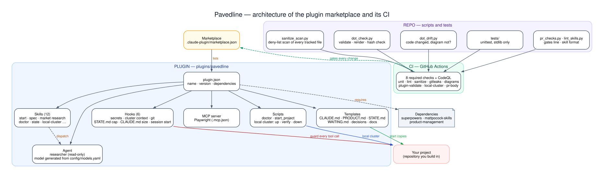

# Architecture

Pavedline is a Claude Code plugin marketplace. This page explains the diagram below: what gets installed, what it
puts in a project, and the gate every change to Pavedline passes.

## 1. Install

`/plugin marketplace add Marwan-G/pavedline` reads [`.claude-plugin/marketplace.json`](../.claude-plugin/marketplace.json),
which lists two plugins: `pavedline` and the optional `pavedline-cockpit` (a status pane for Claude Code 2.1.287 or newer; nothing in
`pavedline` depends on it). `/plugin install pavedline@pavedline` reads its
[`plugin.json`](../plugins/pavedline/.claude-plugin/plugin.json) and installs its dependencies from their own
marketplaces: `superpowers`, `mattpocock-skills`, `product-management` and `figma`; `ui-ux-pro-max` (optional) is a step-7 style reference you may add, and `marketing` (optional) serves the Grow loop after launch. If a dependency is missing, Claude Code does
not load Pavedline at all.

## 2. Inside the plugin

| Part | What it is |
|---|---|
| **Templates** | the project memory files copied into a new project: `CLAUDE.md`, `PRODUCT.md`, `STATE.md`, `WAITING.md`, decision records, docs folders |
| **11 hooks** | checks that run on tool calls and at session events: block reading `.env` files and writing secrets; block cluster commands outside the local `kind-pavedline-*` cluster; block `--no-verify` and force-pushes to the main branch; cap `STATE.md` at 60 lines; warn when `CLAUDE.md` grows past 150 lines; warn when a pull request body lacks the gates line; warn when code changes under a folder whose `ARCHITECTURE.dot` did not; print the project state when a session starts; keep the key `STATE.md` lines through compaction; remind Claude to commit uncommitted records when a turn ends; warn when a builder agent's report lacks its status or gates line (a `SubagentStop` hook; it never blocks) |
| **Scripts** | `doctor` (checks tools and plugins), `start_project` (copies the templates), `apply_stack` (step 6: copies the stack pack), `plan_graph` (checks a wave's plan), and the local cluster's `up`, `verify`, `push` and `down` |
| **Stack pack** | `stacks/nextjs-fastapi/`: `files/` holds the API (FastAPI, Alembic, tenant-isolation checks), web, website, mobile, shared charts and the database chart; `apply_stack.py` copies the surfaces you chose into your repository at step 6 and never overwrites a file. `example/` is a neutral sample that only Pavedline's own starter check copies over it; it never goes into a product |
| **Infra and CI templates** | `templates/infra/` (a Helm library chart, Argo CD ApplicationSets and add-ons) and `templates/.github/` (records and Renovate workflows); the pack adds per-surface CI, security, end-to-end, OpenAPI and image-build workflows. Actions are pinned by SHA and images by digest |
| **32 skills, 9 agents, MCP** | the guided steps 0 to 12 (start, market research, spec, system design, data and API, architecture, design, plan, build, deploy, learn, go to production), the integration wave and the Grow loop (`seo-foundation`, `content-ops`), nine agents (`researcher`, `architect`, `reviewer`, `designer`, `design-verifier`, `builder`, `adversary`, `deployer`, `growth`), and the Playwright MCP server for reading real web pages |
| **Infra profiles** | `templates/infra/profiles/`: `byo-kubernetes` (a bootstrap script for a cluster you own) and `oci-oke` (OpenTofu or Terraform files for OCI, with a plan check). Both are used at step 12; every apply and bootstrap is the founder's |
| **Alerts add-on and backups** | `templates/infra/k8s/addons/alerts/` is a CronJob that checks the public endpoints, the last backup and late scheduled jobs and posts to a notify URL; the database chart backs up to object storage with the Barman Cloud plugin, and `restore_drill.sh` proves a restore |

## 3. In your project

- **Repository:** `/pavedline:start` copies the templates, so any new session resumes from files, not from memory.
- **Claude Code session:** the skills guide each step and the hooks check every command before it runs.
- **Your machine:** `up.sh` builds a local Kubernetes cluster (kind, Argo CD, CloudNativePG, a Gateway API controller,
  a local registry and a small local git server, `kind-git`) bound to `127.0.0.1` only. See [environments](environments.md).
- **The integration wave:** `up.sh --fakes` adds Mailpit and an SMS sink, `tunnel.sh` a Cloudflare quick tunnel for webhook tests, and `up.sh --full` three database instances with a local S3 store (SeaweedFS) for backups. See [the integration wave](steps/integration-wave.md).
- **The deploy loop (step 10):** `deploy_local.sh` builds each selected app (all by default) with a unique tag, pushes a deploy commit to
  `kind-git`, which Argo CD syncs from, then checks the running pods and the pull request's post-deploy checks. Only
  then is the change `verified (local)`.
- **Production (step 12):** [go to production](steps/12-go-to-production.md) fills an infra profile, then staging, one buffer wave and a promotion by pull request (`promote.py`) to production, gated by `launch_check.py`. After launch the [Grow loop](steps/grow.md) runs.

## 4. Every change to Pavedline

1. **Pull request.** From a maintainer or a contributor's fork; Renovate opens dependency updates weekly.
2. **8 required checks + CodeQL** on GitHub Actions: `unit`, `lint`, `sanitize` (no private names), `gitleaks` (no
   secrets), `diagrams`, `plugin-validate`, `local-cluster` (the real cluster on a fresh Linux machine) and
   `pr-body`. CodeQL scans the Python code and the workflows.
   A separate `starter` check generates a neutral product from the stack pack and builds, tests, boots and deploys it
   to kind; `starter-mobile` builds the mobile apps natively (path-filtered and weekly, never required).
3. **Maintainer review.** The maintainer reviews and tests the change locally, then approves and merges with rebase.
   Nothing reaches `main` otherwise: force-pushes and branch deletion are blocked.
4. **Release.** A tagged version; users get it with `/plugin marketplace update`.

How to report a problem or propose a change: [CONTRIBUTING.md](../CONTRIBUTING.md).
